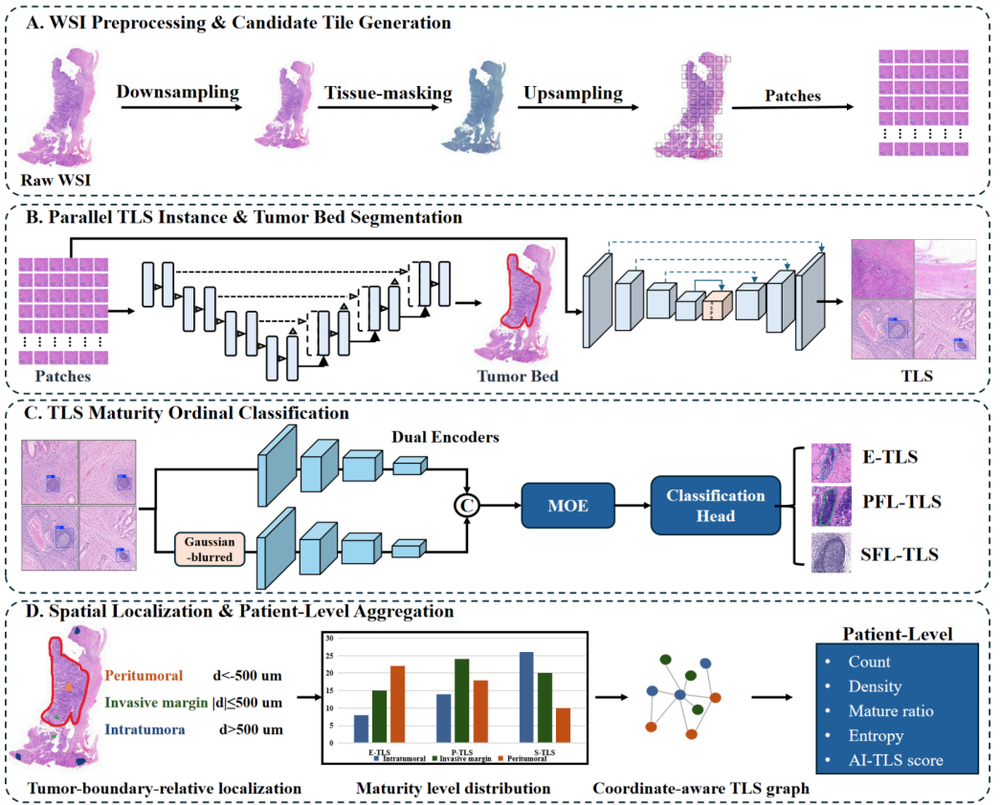

# STELLA-TLS

STELLA-TLS is our public reference implementation for automated analysis of tertiary lymphoid structures (TLS) in H&E whole-slide images.

The workflow takes a whole-slide image through four steps:

1. Generate tissue-qualified candidate tiles while preserving their WSI coordinates.
2. Run TLS instance segmentation and tumor-bed segmentation in parallel.
3. Classify each TLS crop with a dual-view ordinal maturity model into E-TLS, PFL-TLS, or SFL-TLS.
4. Map the results back to the slide and summarize TLS distribution, maturity, and spatial organization at patient level.



## Public models

- **RAPID-TLS**: TLS instance segmentation with multi-scale feature extraction and auxiliary structure-aware prediction heads.
- **GATE-TB**: tumor-bed semantic segmentation with boundary-aware refinement.
- **ORD-MoE**: dual-view ordinal maturity classification using the original crop and a Gaussian-blurred view.

The package contains the core PyTorch models, training driver, post-processing, coordinate mapping, spatial localization, and patient-level aggregation utilities. It does not include private WSI data, annotations, or production checkpoints.

## Install

```bash
pip install -r requirements.txt
```

## Train the three stages

```bash
python train.py --task tls --data tls_train.npz --out checkpoints/rapid_tls.pt
python train.py --task tumor_bed --data tumor_bed_train.npz --out checkpoints/gate_tb.pt
python train.py --task maturity --data maturity_train.npz --out checkpoints/ord_moe.pt
```

Each task uses a compact `.npz` reference format. See `train.py`, `config.json`, and `output_schema.json` for the public interfaces.
